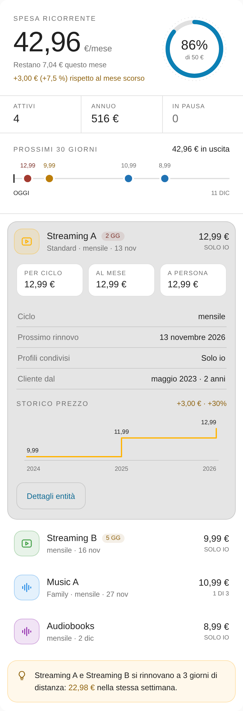
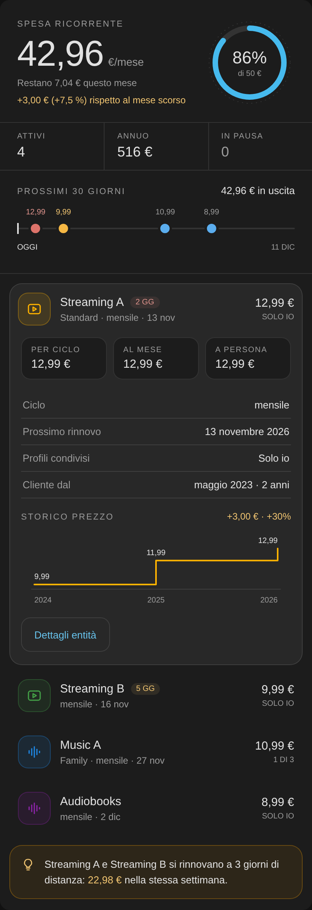
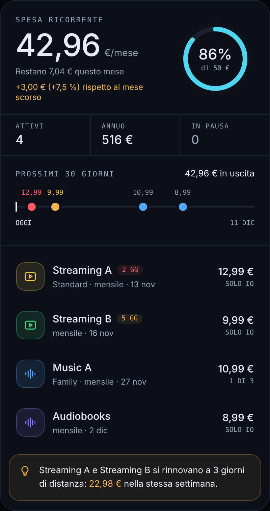
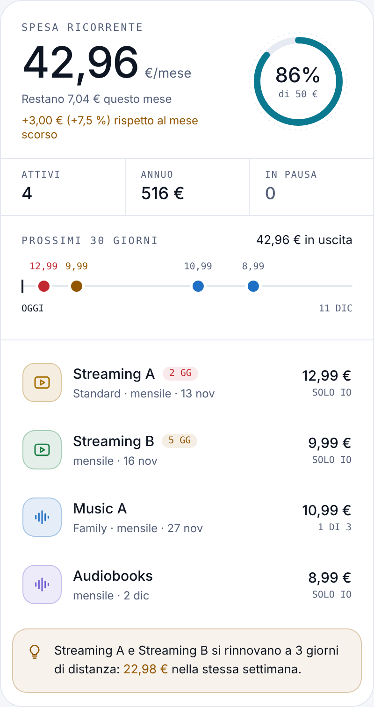

# Subscription Tracker for Home Assistant

Custom integration to track streaming subscriptions: Netflix, Prime Video, Disney+, Paramount+, Crunchyroll, HBO Max, NOW TV, Chili, Apple TV+, DAZN, RaiPlay+, Mediaset Infinity+, TIMvision, Sky, Discovery+, Spotify, Apple Music, Amazon Music, YouTube Music, Tidal, Audible — plus any custom service ("Other").

The user interface of the integration is currently in Italian and English.

## Data entered by the user

Service name (with pre-mapped icon and color), plan/tier, cost per cycle, billing cycle, next renewal date, first subscription date, number of people sharing the account, category, payment method (text note), free notes, "paused" flag.

## Automatically derived data

Each subscription creates a sensor with **state = days until renewal** and these attributes:

| Attribute | Description |
|---|---|
| `monthly_cost` / `yearly_cost` | Normalized cost, so yearly plans are comparable with monthly ones |
| `cost_per_person` | Cost divided by the number of people sharing, or the cost itself if you flagged it as your own share (`cost_is_my_share`, since 0.4.0: for plans held by someone else, where you pay only your quota) |
| `status` | `active` / `expiring_soon` / `paused` |
| `subscribed_days` | For how many days you have been a customer |
| `price_history` | List of `{date, price}` |
| `price_change_total` / `price_change_pct` / `price_changes_count` | Change compared to the first known price |
| `next_renewal` | Effective next renewal (advances by itself, one cycle at a time) |
| `color`, `category`, `display_name` | For rendering in the card |
| `custom_icon` | Icon chosen by the user in the options, or `null`; the card shows it instead of its generic icon |

The payment method is **never** exposed as an attribute: it only stays in the configuration, so it does not end up in the recorder database. Note that the configuration is part of Home Assistant backups, so write a generic note (e.g. "Personal card"), not card digits. Free notes are also visible in the attributes: no personal data.

### Summary sensor and the "Subscription summary" entry

`sensor.subscriptions_total` — state = total monthly cost. It belongs to a dedicated entry, "Subscription summary", created automatically, so it does not depend on any single subscription. Main attributes: `yearly_cost`, `active_count`, `paused_count`, `by_category`, `expiring` (renewals within the notice period), `upcoming` (timeline of renewals in the next 30 days) and `upcoming_total`, `budget`, `budget_used_pct`, `budget_remaining`, `budget_exceeded`. The full list, with types and versioning rules, is in [`docs/attributes-contract.md`](docs/attributes-contract.md).

**Monthly history.** From version 0.3.0 the summary also exposes `previous_month_cost`, `change_vs_previous`, `change_vs_previous_pct` and `monthly_history` (up to 12 months). Totals are recorded by the integration from the day it is updated: the comparison is empty until a full month has been recorded, so nothing is reconstructed for the past.

**Monthly budget.** Set it from Devices & services → Subscription Tracker → "Subscription summary" → Configure. A value of 0 disables the threshold.

If you delete the "Subscription summary" entry while subscriptions still exist, it is created again right away (the budget is reset to none). Once no subscription is left, deleting it is final.

**Mixed currencies.** There is no exchange-rate conversion: totals only sum the subscriptions in the prevailing currency; `mixed_currency` and `other_currency_count` report the excluded ones.

**Automatic renewal.** The renewal date you enter is an anchor: the sensor computes the next renewal by itself by adding whole cycles, without writing anything to the configuration. To stop the count use "paused".

## Dashboard card

The integration includes its own Lovelace card, `custom:subscription-tracker-card`: total recurring spend, change compared with the previous month, monthly budget, 30-day renewal timeline and the list of subscriptions. Tap a row to see the full detail with the price history.

There is nothing to install or register: the integration serves the card itself (`/subscription_tracker/subscription-tracker-card.js`) and adds it to the dashboard resources when it starts, updating it with each new version. If you manage resources in YAML, the card is loaded as a frontend module instead. Add it from the card picker ("Subscription Tracker Card") or with the YAML below.

By default the card inherits the Home Assistant theme, light or dark. The optional `orbit` preset has its own dark and light schemes and follows the Home Assistant mode.

| Home Assistant theme, light | Home Assistant theme, dark |
|---|---|
|  |  |

| Orbit preset, dark | Orbit preset, light |
|---|---|
|  |  |

*Rendered with sample data.*

### Card configuration

Minimal — the card finds all subscriptions by itself:

```yaml
type: custom:subscription-tracker-card
```

All options can be set from the visual editor (card menu → Edit, requires a recent Home Assistant frontend); the YAML below is the same configuration.

Full:

```yaml
type: custom:subscription-tracker-card
summary_entity: sensor.subscriptions_total
theme: auto          # or orbit
mode: auto           # orbit only: auto | dark | light
show_paused: true
show_tip: true
show_timeline: true
show_budget: true
entities:
  - sensor.netflix_premium
  - sensor.dazn_standard
  - sensor.spotify_family
```

| Option | Default | Description |
|---|---|---|
| `summary_entity` | `sensor.subscriptions_total` | Summary sensor of the integration |
| `entities` | auto | Explicit list. If omitted or empty, the card detects the integration's sensors by itself |
| `show_paused` | `true` | Show paused subscriptions at the bottom, dimmed |
| `show_tip` | `true` | Show the contextual tip at the bottom of the card |
| `show_timeline` | `true` | Show the renewals of the next 30 days (`upcoming` attribute of the summary) |
| `show_budget` | `true` | Show the monthly budget ring, if a budget is set in the integration |
| `theme` | `auto` | `auto` inherits the Home Assistant theme; `orbit` applies the Orbit style |
| `mode` | `auto` | Only for `theme: orbit`. `auto` follows Home Assistant (light or dark); `dark` or `light` force the Orbit scheme |

### Themes and customization

All colors use `--stc-*` CSS variables: `--stc-bg` (card), `--stc-surface` (open row), `--stc-border`, `--stc-border-strong`, `--stc-track` (budget ring track), `--stc-text`, `--stc-muted`, `--stc-accent`, `--stc-ok`, `--stc-warn`, `--stc-danger`, `--stc-info`, `--stc-palette-1` … `--stc-palette-6` (one stable color per service), `--stc-radius`, `--stc-row-radius`, `--stc-font`, `--stc-font-display`, `--stc-font-mono`. When not set they inherit the Home Assistant theme; you can redefine them from a theme or with card-mod. The `orbit` preset has a dark and a light scheme (the light one is used when Home Assistant is in light mode, or with `mode: light`); the `--stc-*` variables you define override both. The `orbit` preset loads no external fonts: it uses Space Grotesk, Inter and JetBrains Mono only if they are already installed, otherwise system fonts.

Icons are generic per category (video, audio, other, paused), not brand logos. If you set a custom `mdi:` icon on a subscription in the integration's options, the card shows that icon instead.

### Contextual tip

The box at the bottom is an observation, not a data point, chosen in priority order:

1. Two or more renewals within the same week → shows the total that will go out in those days
2. A paused subscription → suggests considering cancelling it
3. A service that rose by more than 20 % since you became a customer → reports the change

If none of the conditions applies, the box is not shown.

Sorting is by urgency: subscriptions with fewer days to renewal come first, paused ones always last.

The card text and number/date formatting are currently in Italian (`it-IT`).

## Price history

It works in two combined ways:

- **Automatic** — when you change the cost from the integration's Options, the change is recorded with today's date.
- **Manual, retroactive** — the `subscription_tracker.add_price_history` service lets you enter prices from before the installation, so the chart is populated right away.

```yaml
service: subscription_tracker.add_price_history
data:
  entity_id: sensor.netflix_premium
  price: 12.99
  date: "2021-03-01"
```

## Installation

### Home Assistant Marketplace (2026.11 or later)
1. Settings → Marketplace → menu (⋮) → **Add from link** (requires connecting a GitHub account)
2. Enter `ivp-arch/ha-subscription-tracker`
3. Install "Subscription Tracker" and restart Home Assistant

The dashboard card is included (Home Assistant 2025.2 or later).

**Upgrading from 0.4.x with the separate card.** Up to 0.4.x the card was a separate download (`ivp-arch/ha-subscription-tracker-card`). After updating to 0.5.0, uninstall "Subscription Tracker Card" from the Marketplace (or HACS) and, if it remains, delete its resource from Settings → Dashboards → menu (⋮) → Resources, then reload the page clearing the browser cache (the old card may still be cached). Your dashboards keep working with the same card configuration. Until then the integration shows a notice in Settings → Repairs.

### HACS (Home Assistant before 2026.11)
HACS → Integrations → menu (⋮) → Custom repositories → add this repo's URL, category "Integration".

### Manual
Copy `custom_components/subscription_tracker` (including its `www` folder) into the `custom_components` folder of your instance, then restart.

## Configuration

Settings → Devices & services → Add integration → "Subscription Tracker". Repeat for each subscription. Data can be edited from the integration's Options, without removing and recreating it.

## Automations

The summary sensor makes the most useful automations simple:

```yaml
# Weekly notice about upcoming renewals
trigger:
  - platform: time
    at: "09:00:00"
condition:
  - condition: template
    value_template: "{{ state_attr('sensor.subscriptions_total','expiring_count') | int > 0 }}"
action:
  - service: notify.mobile_app
    data:
      title: Upcoming renewals
      message: >-
        
        {{ s.name }}: {{ s.cost }} € in {{ s.days }} days.
        
```

```yaml
# Budget threshold exceeded (the budget is set in the "Subscription summary" entry)
trigger:
  - platform: state
    entity_id: sensor.subscriptions_total
    attribute: budget_exceeded
    to: true
action:
  - service: notify.mobile_app
    data:
      message: "Subscription spending is above the monthly budget."
```

```yaml
# Price increase detected on a service
trigger:
  - platform: state
    entity_id: sensor.netflix_premium
    attribute: price_changes_count
action:
  - service: notify.mobile_app
    data:
      message: >-
        Netflix changed its price: now {{ state_attr('sensor.netflix_premium','cost') }} €,
        {{ state_attr('sensor.netflix_premium','price_change_pct') }} % compared to the start.
```

## Development

Calculations live in `custom_components/subscription_tracker/calc.py`, with no dependency on Home Assistant. The tests (`tests/`) use `pytest-homeassistant-custom-component`:

```bash
pip install -r requirements_test.txt
pytest
```

## Roadmap

- Selector option labels translated in the configuration UI
- Ready-to-use automation blueprints

## Note

The integration does not connect to real service accounts: data is entered manually. It handles no credentials or payments.
